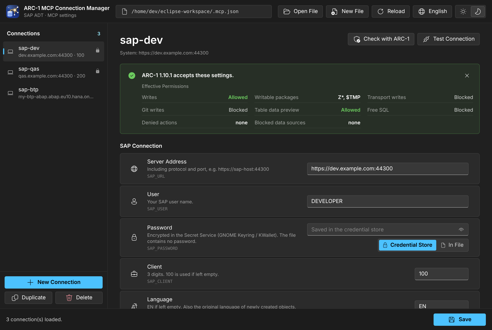
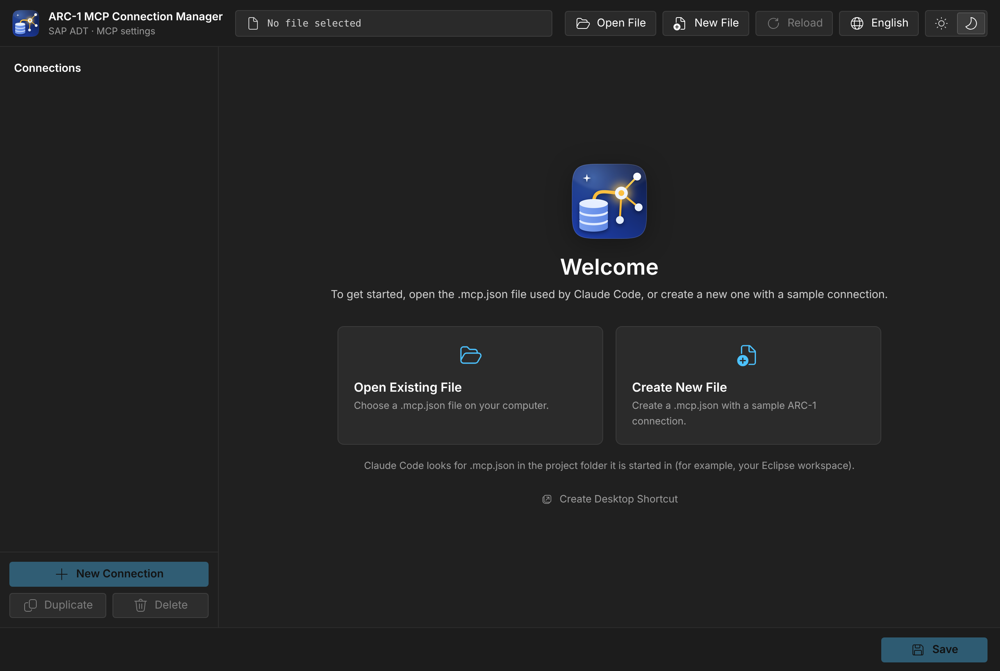

<div align="center">


# ARC-1 MCP Connection Manager

**A desktop app for the SAP connections in your `.mcp.json` for [ARC-1](https://github.com/arc-mcp/arc-1). Passwords stay in your operating system's credential store, ARC-1 itself checks your settings, and the setting catalog follows every ARC-1 release.**

**English** | [Türkçe](README.tr.md)

[](https://www.npmjs.com/package/arc1-connection-manager)


[](LICENSE)

</div>

<p align="center"></p>

## Why?

ARC-1 lets AI assistants such as Claude Code work with SAP ABAP systems through ADT. Each SAP system is an entry in `.mcp.json`, configured with environment variables such as `SAP_URL`, `SAP_USER` or `SAP_ALLOW_WRITES`. Edited by hand, that file causes three problems:

- **The password sits in plain text** in a file inside your project folder.
- **A typo is silently ignored** (`SAP_ALOW_WRITES` does nothing), and an outdated key stops ARC-1 from starting.
- **ARC-1 keeps evolving**, so any hand-made list of valid settings goes stale.

ARC-1 MCP Connection Manager solves all three: a form for each connection, passwords in the operating system's credential store, a setting catalog generated from ARC-1's own code, and a button that lets ARC-1 itself check your settings.

## Quick start

You need [Node.js](https://nodejs.org/) **22.19 or newer**, which ARC-1 needs anyway. There is nothing to install.

```sh
cd C:\Users\<you>\eclipse-workspace      # the folder you start Claude Code in
npx arc1-connection-manager
```

The app opens in its own window (an Edge or Chrome app window, otherwise your default browser). If the current folder has a `.mcp.json`, it opens right away.

1. Fill in **Server Address**, **User**, **Password**, **Client** and **Language**. Leave the password on **Credential Store**.
2. Click **Test Connection** to sign in to the ADT service.
3. Add what you need with **Add Setting**, for example **Allow Writes** and **Writable Packages**.
4. Click **Check with ARC-1** to see whether ARC-1 accepts the settings and which permissions apply.
5. Click **Save** (Ctrl+S), then **restart Claude Code**. The first time, Claude Code asks you to approve the project's MCP servers.

For an icon, run `npx arc1-connection-manager --shortcut` or click **Create Desktop Shortcut** on the welcome screen. It adds a desktop and Start menu shortcut.

<details>
<summary>Welcome screen</summary>
<p align="center"></p>
</details>

## Passwords in the credential store

With **Credential Store** selected, the operating system keeps the password encrypted:

| System | Where |
|---|---|
| Windows | Credential Manager → Windows Credentials → Generic Credentials (`…arc1-connection-manager`) |
| macOS | Keychain |
| Linux | Secret Service (GNOME Keyring, KWallet) |

`.mcp.json` then contains no password. ARC-1 is started through a small launcher instead:

```json
"sap-dev": {
  "command": "cmd",
  "args": ["/c", "npx", "-y", "arc1-connection-manager@1", "run", "--", "npx", "-y", "arc-1"],
  "env": {
    "SAP_URL": "https://sap-host:44300",
    "SAP_USER": "DEVELOPER",
    "SAP_CLIENT": "100"
  }
}
```

- `run` reads the password for this server, user and client from the credential store, adds it as `SAP_PASSWORD` and starts the command after `--`. ARC-1 talks to Claude Code directly; the launcher never touches the MCP traffic and writes nothing to its output.
- Connections with the same server, user and client share one stored password.
- The file is safe to share or commit: each colleague enters their own password once, in this app, on their own machine.
- You can switch to **In File** at any time; the password is then written into `.mcp.json` as plain text.
- On Linux without a running Secret Service, only **In File** is available.

## Check with ARC-1

**Check with ARC-1** runs ARC-1's own configuration check (`arc1-cli config show`) through `npx`, with the ARC-1 version the connection uses (`arc-1`, or a pinned `arc-1@1.10.1`). If ARC-1 would refuse to start, you see its exact message. Otherwise you see the effective permissions: writes, writable packages, transports, Git, data preview, free SQL and denied actions. The password is not passed to this check.

## A catalog that follows ARC-1

- `catalog/arc1.json` is generated from ARC-1's code by [`scripts/sync-arc1.mjs`](scripts/sync-arc1.mjs). It lists every setting ARC-1 reads, with type, default and allowed values, the removed keys that stop ARC-1 from starting, and the keys it ignores.
- Once a week a [GitHub Action](.github/workflows/arc1-sync.yml) checks the latest ARC-1 release and opens a pull request when something changed. The tests fail if the curated catalog no longer matches ARC-1.
- Unknown keys are flagged with a suggestion, for example **Did you mean SAP_ALLOW_WRITES?**, and can be renamed with one click.
- Keys ARC-1 no longer accepts (`SAP_READ_ONLY`, `ARC1_PROFILE`, …) show ARC-1's own message and convert with one click.
- Values are checked the way ARC-1 reads them, and values that would stop ARC-1 from starting are marked.

## More features

- Add, rename, duplicate and delete connections. Other MCP servers in the file are listed separately and kept exactly as they are.
- The file keeps its formatting: indentation, line endings, BOM, key order and any other fields.
- Every save first copies the current file to `.mcp.json.bak`.
- Changes made outside the app are detected: the app reloads the file, or asks first if you have unsaved changes.
- Works with Claude Code's `.mcp.json`, Claude Desktop's `claude_desktop_config.json` and VS Code's `mcp.json` (`servers`). Files with comments can be opened; saving removes the comments after asking.
- On Windows it warns when `npx` is started without `cmd /c`, which Claude Code needs there, and fixes it with one click.
- 14 languages, light and dark theme. The app remembers your language, theme and recent files.

## Security

- The interface runs on `127.0.0.1` only, on a random port, with a token for each session. Requests from other web pages are rejected by Host, Origin and Sec-Fetch-Site checks and a strict Content Security Policy.
- No telemetry. The app connects to two places only: your SAP server for **Test Connection**, and the npm registry when `npx` fetches ARC-1 for **Check with ARC-1**.
- New files are created readable only by you (macOS and Linux).
- If you keep a password **In File**, keep `.mcp.json` and `.mcp.json.bak` out of Git:
  ```gitignore
  .mcp.json
  .mcp.json.bak
  ```
- One runtime dependency, [`@napi-rs/keyring`](https://github.com/Brooooooklyn/keyring-node), with prebuilt binaries and nothing to compile.
- The launcher in `.mcp.json` follows major version 1. Write an exact version (`arc1-connection-manager@1.0.0`) if your policy requires it.

## Command line

```text
npx arc1-connection-manager [file] [options]

  file                 MCP configuration to open (default: ./.mcp.json, else the last file)
  --port <number>      Port for the local interface (default: random)
  --no-open            Do not open a window; only print the address
  --browser default    Use the default browser instead of an app window
  --keep-alive         Keep running after the window is closed
  --shortcut           Create a desktop / Start menu shortcut and exit
  -v, --version        Print the version
```

The app stops by itself shortly after you close its window.

## Where things are stored

| What | Where |
|---|---|
| Your connections | Your `.mcp.json`, wherever it is. The app never moves it. |
| Backup | `.mcp.json.bak` next to it |
| Passwords (Credential Store) | Windows Credential Manager / macOS Keychain / Secret Service |
| App preferences | Windows `%APPDATA%\arc1-connection-manager`, macOS `~/Library/Application Support/arc1-connection-manager`, Linux `~/.config/arc1-connection-manager` |

## Troubleshooting

| Problem | Solution |
|---|---|
| `npx` is not found | Install Node.js 22.19 or newer from [nodejs.org](https://nodejs.org/). |
| No window opens | Open the address printed in the terminal, or start with `--browser default`. |
| ARC-1 does not start and Claude Code's MCP log says `[arc1-connection-manager] No password is stored for …` | Open the app, enter the password for that connection and save. |
| macOS asks whether `node` may use the keychain | Choose **Always Allow**. |
| Linux: "credential store is not available" | Install and unlock GNOME Keyring or KWallet, or use **In File**. |
| Test Connection: certificate error | Add **Skip SSL Verification** to the connection, or trust your company's root certificate with the `NODE_EXTRA_CA_CERTS` environment variable (ARC-1 uses it too). Avoid `NODE_TLS_REJECT_UNAUTHORIZED=0`: it turns off certificate checks for every Node.js program. |
| Test Connection: HTTP 401 / 403 / 404 | 401: wrong user or password. 403: signed in, but no ADT authorization. 404: the ADT service `/sap/bc/adt` is not active in transaction SICF. |
| Check with ARC-1 times out | `npx` needs the npm registry. Behind a proxy, set it with `npm config set proxy …` and `npm config set https-proxy …`. |
| Changes have no effect | Restart Claude Code after saving. |

## Development

```sh
git clone https://github.com/abdullahatan/arc1-connection-manager
cd arc1-connection-manager
npm ci
npm start            # run the app from source
npm test             # unit and API tests (node:test)
npm run check        # catalog matches ARC-1, all languages complete
npm run sync-arc1    # regenerate catalog/arc1.json from the latest ARC-1 on npm
ARC1CM_REAL_KEYRING=1 node --test test/keyring-real.test.js   # test against your real credential store
```

```text
bin/        command line entry point
src/        local server, .mcp.json handling, credential store, run launcher, ARC-1 check
public/     the interface (plain HTML, CSS and JavaScript, no build step)
catalog/    catalog.json (curated) and arc1.json (generated from ARC-1)
locales/    interface texts, 14 languages
scripts/    ARC-1 parser and sync, language check
test/       tests
```

**Adding a language:** copy `locales/en.json` to `locales/<code>.json` (for example `sv` or `pt-PT`), translate the values and keep the `{0}` placeholders. `npm run check` lists anything missing. The app picks up the new language automatically.

**When ARC-1 adds a setting:** the weekly sync opens a pull request that lists it. Add it to `catalog/catalog.json` (group, type, default) with its label in `locales/en.json`, or under `serverOnly` if it only matters for HTTP or BTP server deployments.

**Releasing:** raise `version` in `package.json` and create a GitHub release with the tag `vX.Y.Z`. The [publish workflow](.github/workflows/publish.yml) runs the tests and publishes to npm with [trusted publishing](https://docs.npmjs.com/trusted-publishers), so no token is stored. A version that is already on npm is skipped. npm only allows trusted publishing for a package that already exists, so the very first version is published by hand with `npm login` and `npm publish --access public`.

## License

[MIT](LICENSE) © 2026 Abdullah Atan. Icons: [Fluent UI System Icons](https://github.com/microsoft/fluentui-system-icons) (MIT); see [THIRD-PARTY-NOTICES.md](THIRD-PARTY-NOTICES.md).

## Credits

[ARC-1](https://github.com/arc-mcp/arc-1) is created by Marian Zeis and is MIT licensed. This app edits ARC-1's configuration and reads ARC-1's configuration code to build its catalog; it does not include ARC-1 itself.
