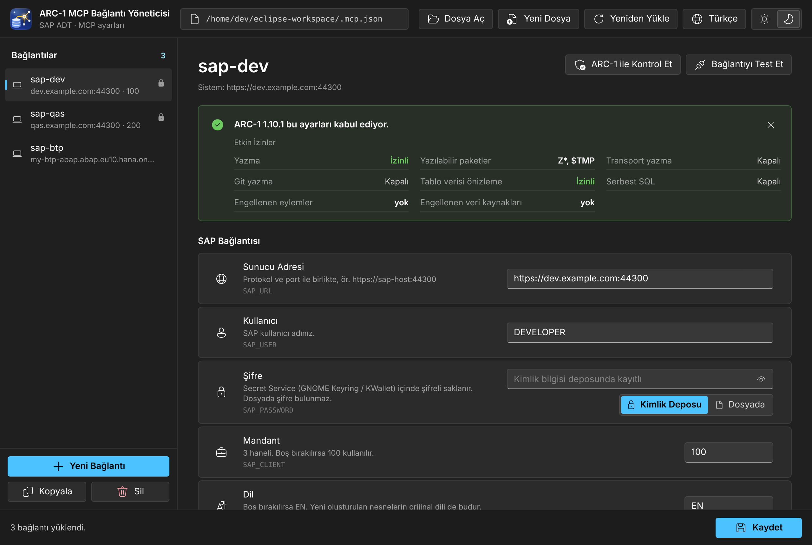
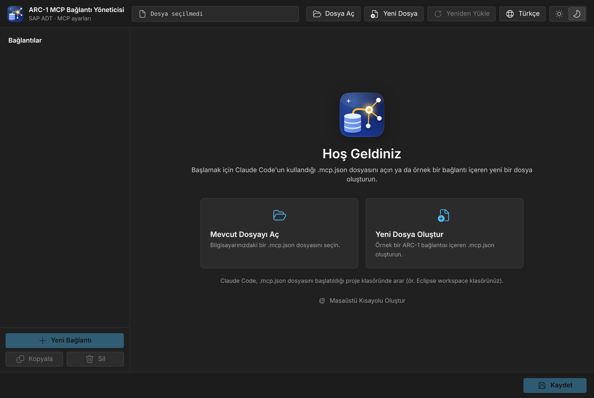

<div align="center">


# ARC-1 MCP Bağlantı Yöneticisi

**[ARC-1](https://github.com/arc-mcp/arc-1) için `.mcp.json` dosyanızdaki SAP bağlantılarını yöneten masaüstü uygulaması. Şifreler işletim sisteminin kimlik bilgisi deposunda kalır, ayarlarınızı ARC-1'in kendisi kontrol eder, ayar kataloğu her ARC-1 sürümünü takip eder.**

[English](README.md) | **Türkçe**

[](https://www.npmjs.com/package/arc1-connection-manager)


[](LICENSE)

</div>

<p align="center"></p>

## Neden?

ARC-1, Claude Code gibi yapay zekâ asistanlarının ADT üzerinden SAP ABAP sistemleriyle çalışmasını sağlar. Her SAP sistemi `.mcp.json` içinde ayrı bir kayıttır ve `SAP_URL`, `SAP_USER`, `SAP_ALLOW_WRITES` gibi ortam değişkenleriyle ayarlanır. Bu dosya elle düzenlendiğinde üç sorun çıkar:

- **Şifre düz metin olarak** proje klasörünüzdeki bir dosyada durur.
- **Yazım hatası sessizce yok sayılır** (`SAP_ALOW_WRITES` hiçbir şey yapmaz), ARC-1'in artık kabul etmediği bir anahtar ise ARC-1'in hiç açılmamasına yol açar.
- **ARC-1 sürekli gelişir**, elle tutulan bir geçerli ayarlar listesi kısa sürede eskir.

ARC-1 MCP Bağlantı Yöneticisi üçünü de çözer: her bağlantı için bir form, işletim sisteminin kimlik bilgisi deposunda saklanan şifreler, ARC-1'in kendi kodundan üretilen bir ayar kataloğu ve ayarlarınızı ARC-1'in kendisine kontrol ettiren bir düğme.

## Hızlı başlangıç

[Node.js](https://nodejs.org/) **22.19 veya üstü** gerekir; ARC-1 için zaten gerekiyor. Ayrıca bir şey kurmanız gerekmez.

```sh
cd C:\Users\<kullanıcı>\eclipse-workspace   # Claude Code'u başlattığınız klasör
npx arc1-connection-manager
```

Uygulama kendi penceresinde açılır (Edge veya Chrome uygulama penceresi, yoksa varsayılan tarayıcınız). Bulunduğunuz klasörde `.mcp.json` varsa hemen açılır.

1. **Sunucu Adresi**, **Kullanıcı**, **Şifre**, **Mandant** ve **Dil** alanlarını doldurun. Şifreyi **Kimlik Deposu** seçeneğinde bırakın.
2. ADT servisine giriş yapmayı denemek için **Bağlantıyı Test Et**'e tıklayın.
3. Gerekenleri **Ayar Ekle** ile ekleyin; örneğin **Yazma İzni** ve **Yazılabilir Paketler**.
4. ARC-1'in ayarları kabul edip etmediğini ve hangi izinlerin geçerli olduğunu görmek için **ARC-1 ile Kontrol Et**'e tıklayın.
5. **Kaydet**'e tıklayın (Ctrl+S), ardından **Claude Code'u yeniden başlatın**. Claude Code ilk seferde projenin MCP sunucularını onaylamanızı ister.

Simge için `npx arc1-connection-manager --shortcut` komutunu çalıştırın ya da karşılama ekranındaki **Masaüstü Kısayolu Oluştur**'a tıklayın. Masaüstüne ve Başlat menüsüne kısayol eklenir.

<details>
<summary>Karşılama ekranı</summary>
<p align="center"></p>
</details>

## Şifreler kimlik bilgisi deposunda

**Kimlik Deposu** seçiliyken şifreyi işletim sistemi şifreli olarak saklar:

| Sistem | Nerede |
|---|---|
| Windows | Kimlik Bilgileri Yöneticisi → Windows Kimlik Bilgileri → Genel Kimlik Bilgileri (`…arc1-connection-manager`) |
| macOS | Anahtar Zinciri |
| Linux | Secret Service (GNOME Keyring, KWallet) |

Bu durumda `.mcp.json` içinde şifre yer almaz. ARC-1 bunun yerine küçük bir başlatıcı üzerinden çalıştırılır:

```json
"sap-dev": {
  "command": "cmd",
  "args": ["/c", "npx", "-y", "arc1-connection-manager@1", "run", "--", "npx", "-y", "arc-1"],
  "env": {
    "SAP_URL": "https://sap-host:44300",
    "SAP_USER": "DEVELOPER",
    "SAP_CLIENT": "100"
  }
}
```

- `run`, bu sunucu, kullanıcı ve mandant için kayıtlı şifreyi kimlik bilgisi deposundan okur, `SAP_PASSWORD` olarak ekler ve `--` sonrasındaki komutu başlatır. ARC-1 Claude Code ile doğrudan konuşur; başlatıcı MCP trafiğine dokunmaz ve çıktısına hiçbir şey yazmaz.
- Aynı sunucu, kullanıcı ve mandanta sahip bağlantılar tek bir kayıtlı şifreyi paylaşır.
- Dosya paylaşılabilir ve Git'e eklenebilir: her ekip arkadaşı kendi şifresini kendi bilgisayarında, bu uygulamada bir kez girer.
- İstediğiniz zaman **Dosyada** seçeneğine geçebilirsiniz; şifre bu durumda `.mcp.json` içine düz metin olarak yazılır.
- Secret Service çalışmayan Linux sistemlerde yalnızca **Dosyada** seçeneği kullanılabilir.

## ARC-1 ile kontrol

**ARC-1 ile Kontrol Et**, ARC-1'in kendi yapılandırma kontrolünü (`arc1-cli config show`) `npx` üzerinden, bağlantının kullandığı ARC-1 sürümüyle çalıştırır (`arc-1` ya da sabitlenmiş `arc-1@1.10.1`). ARC-1 bu ayarlarla açılmayacaksa onun mesajını aynen görürsünüz. Açılacaksa etkin izinleri görürsünüz: yazma, yazılabilir paketler, transport, Git, veri önizleme, serbest SQL ve engellenen eylemler. Şifre bu kontrole gönderilmez.

## ARC-1'i takip eden katalog

- `catalog/arc1.json`, ARC-1'in kodundan [`scripts/sync-arc1.mjs`](scripts/sync-arc1.mjs) ile üretilir. İçinde ARC-1'in okuduğu her ayar türü, varsayılanı ve izin verilen değerleriyle yer alır. ARC-1'in açılmasını engelleyen kaldırılmış anahtarlar ve yok saydığı anahtarlar da buradadır.
- Haftada bir [GitHub Action](.github/workflows/arc1-sync.yml) en son ARC-1 sürümünü kontrol eder ve bir değişiklik varsa pull request açar. Küratörlü katalog ARC-1 ile uyuşmazsa testler başarısız olur.
- Tanınmayan anahtarlar bir öneriyle işaretlenir (örneğin **SAP_ALLOW_WRITES mı demek istediniz?**) ve tek tıkla yeniden adlandırılabilir.
- ARC-1'in artık kabul etmediği anahtarlar (`SAP_READ_ONLY`, `ARC1_PROFILE`, …) ARC-1'in kendi mesajıyla gösterilir ve tek tıkla dönüştürülür.
- Değerler ARC-1'in onları okuduğu şekilde kontrol edilir; ARC-1'in açılmasını engelleyecek değerler işaretlenir.

## Diğer özellikler

- Bağlantı ekleme, yeniden adlandırma, kopyalama ve silme. Dosyadaki diğer MCP sunucuları ayrı listelenir ve olduğu gibi korunur.
- Dosyanın biçimi korunur: girinti, satır sonları, BOM, anahtar sırası ve diğer tüm alanlar.
- Her kayıttan önce mevcut dosya `.mcp.json.bak` olarak kopyalanır.
- Uygulama dışında yapılan değişiklikler fark edilir: kaydedilmemiş değişikliğiniz yoksa dosya yeniden yüklenir, varsa önce size sorulur.
- Claude Code'un `.mcp.json`, Claude Desktop'ın `claude_desktop_config.json` ve VS Code'un `mcp.json` (`servers`) dosyalarıyla çalışır. Yorum satırı içeren dosyalar açılabilir; kaydederken yorumlar size sorulduktan sonra kaldırılır.
- Windows'ta, Claude Code'un ihtiyaç duyduğu `cmd /c` olmadan başlatılan `npx` komutları için uyarır ve tek tıkla düzeltir.
- 14 dil, açık ve koyu tema. Dil, tema ve son kullanılan dosyalar hatırlanır.

## Güvenlik

- Arayüz yalnızca `127.0.0.1` üzerinde, rastgele bir portta ve her oturuma özel bir anahtarla çalışır. Başka web sayfalarından gelen istekler Host, Origin ve Sec-Fetch-Site kontrolleri ile sıkı bir içerik güvenlik politikası (CSP) sayesinde reddedilir.
- Telemetri yoktur. Uygulama yalnızca iki yere bağlanır: **Bağlantıyı Test Et** için SAP sunucunuza, **ARC-1 ile Kontrol Et** sırasında `npx` ARC-1'i indirirken npm kayıt sunucusuna.
- Yeni dosyalar yalnızca sizin okuyabileceğiniz şekilde oluşturulur (macOS ve Linux).
- Şifreyi **Dosyada** tutuyorsanız `.mcp.json` ve `.mcp.json.bak` dosyalarını Git dışında tutun:
  ```gitignore
  .mcp.json
  .mcp.json.bak
  ```
- Tek bir çalışma zamanı bağımlılığı vardır: [`@napi-rs/keyring`](https://github.com/Brooooooklyn/keyring-node). Önceden derlenmiştir, derleme gerektirmez.
- `.mcp.json` içindeki başlatıcı 1 ana sürümünü takip eder. Şirket politikanız gerektiriyorsa tam sürümü yazın (`arc1-connection-manager@1.0.0`).

## Komut satırı

```text
npx arc1-connection-manager [dosya] [seçenekler]

  dosya                Açılacak MCP yapılandırması (varsayılan: ./.mcp.json, yoksa son dosya)
  --port <sayı>        Yerel arayüzün portu (varsayılan: rastgele)
  --no-open            Pencere açma; yalnızca adresi yaz
  --browser default    Uygulama penceresi yerine varsayılan tarayıcıyı kullan
  --keep-alive         Pencere kapatılınca da çalışmaya devam et
  --shortcut           Masaüstü / Başlat menüsü kısayolu oluştur ve çık
  -v, --version        Sürümü yaz
```

Uygulama, penceresini kapattıktan kısa süre sonra kendiliğinden durur.

## Dosyaların konumları

| Ne | Nerede |
|---|---|
| Bağlantılarınız | `.mcp.json` dosyanız neredeyse orada. Uygulama onu taşımaz. |
| Yedek | Hemen yanında `.mcp.json.bak` |
| Şifreler (Kimlik Deposu) | Windows Kimlik Bilgileri Yöneticisi / macOS Anahtar Zinciri / Secret Service |
| Uygulama tercihleri | Windows `%APPDATA%\arc1-connection-manager`, macOS `~/Library/Application Support/arc1-connection-manager`, Linux `~/.config/arc1-connection-manager` |

## Sorun giderme

| Sorun | Çözüm |
|---|---|
| `npx` bulunamıyor | [nodejs.org](https://nodejs.org/) adresinden Node.js 22.19 veya üstünü kurun. |
| Pencere açılmıyor | Terminalde yazan adresi açın ya da `--browser default` ile başlatın. |
| ARC-1 açılmıyor ve Claude Code'un MCP günlüğünde `[arc1-connection-manager] No password is stored for …` yazıyor | Uygulamayı açın, o bağlantının şifresini girin ve kaydedin. |
| macOS, `node` için anahtar zinciri izni soruyor | **Her Zaman İzin Ver**'i seçin. |
| Linux: "kimlik bilgisi deposu kullanılamıyor" | GNOME Keyring veya KWallet kurup kilidini açın ya da **Dosyada** seçeneğini kullanın. |
| Bağlantı testi: sertifika hatası | Bağlantıya **SSL Doğrulamasını Atla** ayarını ekleyin ya da şirketinizin kök sertifikasını `NODE_EXTRA_CA_CERTS` ortam değişkeniyle tanıtın (ARC-1 de bunu kullanır). `NODE_TLS_REJECT_UNAUTHORIZED=0` kullanmayın: bütün Node.js programlarında sertifika kontrolünü kapatır. |
| Bağlantı testi: HTTP 401 / 403 / 404 | 401: kullanıcı adı veya şifre yanlış. 403: giriş yapıldı ama ADT yetkisi yok. 404: ADT servisi (`/sap/bc/adt`) SICF işleminde etkin değil. |
| ARC-1 kontrolü zaman aşımına uğruyor | `npx` için npm kayıt sunucusuna erişim gerekir. Proxy arkasındaysanız `npm config set proxy …` ve `npm config set https-proxy …` ile ayarlayın. |
| Değişiklikler etkili olmuyor | Kaydettikten sonra Claude Code'u yeniden başlatın. |

## Geliştirme

```sh
git clone https://github.com/abdullahatan/arc1-connection-manager
cd arc1-connection-manager
npm ci
npm start            # uygulamayı kaynak koddan çalıştır
npm test             # birim ve API testleri (node:test)
npm run check        # katalog ARC-1 ile uyumlu, tüm diller eksiksiz
npm run sync-arc1    # catalog/arc1.json dosyasını npm'deki en son ARC-1'den yeniden üret
ARC1CM_REAL_KEYRING=1 node --test test/keyring-real.test.js   # gerçek kimlik deponuzla test et
```

```text
bin/        komut satırı giriş noktası
src/        yerel sunucu, .mcp.json işlemleri, kimlik deposu, run başlatıcısı, ARC-1 kontrolü
public/     arayüz (düz HTML, CSS ve JavaScript, derleme adımı yok)
catalog/    catalog.json (küratörlü) ve arc1.json (ARC-1'den üretilir)
locales/    arayüz metinleri, 14 dil
scripts/    ARC-1 ayrıştırıcısı ve senkronu, dil kontrolü
test/       testler
```

**Yeni dil ekleme:** `locales/en.json` dosyasını `locales/<kod>.json` olarak kopyalayın (örneğin `sv` veya `pt-PT`), değerleri çevirin ve `{0}` yer tutucularını koruyun. Eksikleri `npm run check` listeler. Uygulama yeni dili otomatik olarak tanır.

**ARC-1 yeni bir ayar eklediğinde:** haftalık senkron, ayarı listeleyen bir pull request açar. Ayarı `catalog/catalog.json` dosyasına (grup, tür, varsayılan) ve etiketini `locales/en.json` dosyasına ekleyin. Ayar yalnızca HTTP veya BTP sunucu kurulumlarında önemliyse `serverOnly` listesine ekleyin.

**Sürüm yayımlama:** `package.json` içindeki `version` değerini artırın ve `vX.Y.Z` etiketiyle bir GitHub sürümü (release) oluşturun. [Yayımlama iş akışı](.github/workflows/publish.yml) testleri çalıştırır ve paketi [güvenilir yayımlama (trusted publishing)](https://docs.npmjs.com/trusted-publishers) ile npm'e yayımlar; hiçbir token saklanmaz. npm'de zaten bulunan bir sürüm atlanır. npm güvenilir yayımlamaya yalnızca zaten var olan bir paket için izin verdiğinden ilk sürüm `npm login` ve `npm publish --access public` ile elle yayımlanır.

## Lisans

[MIT](LICENSE) © 2026 Abdullah Atan. Simgeler: [Fluent UI System Icons](https://github.com/microsoft/fluentui-system-icons) (MIT); bkz. [THIRD-PARTY-NOTICES.md](THIRD-PARTY-NOTICES.md).

## Teşekkür

[ARC-1](https://github.com/arc-mcp/arc-1), Marian Zeis tarafından geliştirilmiştir ve MIT lisanslıdır. Bu uygulama ARC-1'in yapılandırmasını düzenler ve kataloğunu oluşturmak için ARC-1'in yapılandırma kodunu okur; ARC-1'in kendisini içermez.
